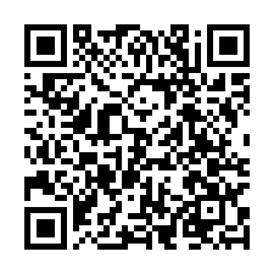

# TINY 2.1 for the Nintendo 3DS

A 367,000-parameter transformer — 4 layers, 96 wide, 8-bit weights, letters in
and letters out — running on a 3DS as an ordinary homebrew title. The
conversation is on the top screen, a live neural monitor on the bottom one, the
3DS software keyboard takes the question, and the robot voice is synthesised
into the DSP.

## Download

[](https://github.com/paige-morningstar/Tiny-2.1/releases/download/v1.0/tiny21.cia)

One click gets you **`tiny21.cia`** (641 KB). Install it with FBI (Titles → SD,
or any title manager), then launch **TINY 2.1** from the home menu. Custom
firmware (Luma3DS) required. The network and its 380 KB of weights are inside
the title, so nothing else has to be copied to the SD card.

To install straight from the 3DS, open **FBI → Remote Install → Scan QR Code**
and point the camera at this:



Or copy the direct link: <https://github.com/paige-morningstar/Tiny-2.1/releases/download/v1.0/tiny21.cia>

The title ID is `0x000400000F716900`, so it installs alongside anything else and
updates over itself.

## Controls

| Button | Does |
| --- | --- |
| A | ask a question |
| SELECT | help |
| X | sound on/off |
| Y | robot voice on/off |
| L / R | creativity 0-9 (0 = always the surest answer) |
| Up | ask the last question again |
| B | stop the voice, or stop a long answer |
| START | quit |

Typing `HELP`, `CLS`, `QUIT` or `EXIT` as the question does the obvious thing.

## Build from source

Needs devkitPro with devkitARM and libctru. Everything lives in `3ds/`:

```
cd 3ds
make        # tiny21.3dsx + tiny21.smdh for the Homebrew Launcher
make cia    # tiny21.cia, needs makerom on the PATH
```

`make cia` builds the title from the banner, icon and tune already committed in
`3ds/assets/`, so makerom is the only extra tool required.

## What is in here

```
3ds/source/tiny_model.c   the network: no 3DS and no DOS code in it
3ds/source/main.c         the 3DS front end: screens, keyboard, voice
3ds/include/              the model's interface
3ds/romfs/TINY.BIN        the trained weights, embedded into the app
3ds/assets/               banner, icon and banner tune
3ds/tiny.rsf              the ROM spec for the CIA
3ds/tools/                banner generator, and a host test for the network
```

Because `tiny_model.c` is portable, the network also runs on a PC for testing —
see `3ds/README.md`, which also covers the SD-card override
(`sdmc:/3ds/TINY/TINY.BIN`) for a retrained model.
